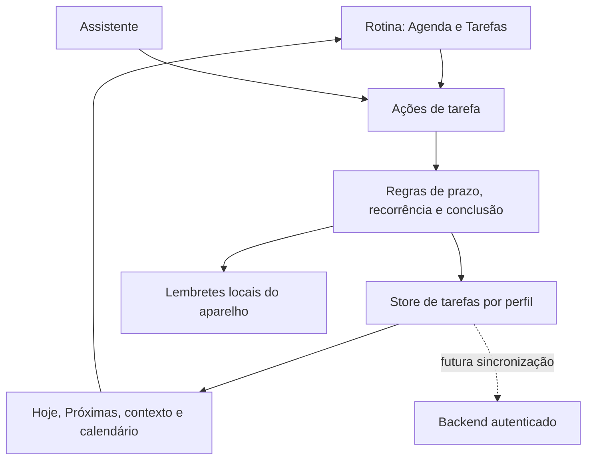

# Organização do Fluxo

## Objetivo

Reunir calendário e tarefas numa rotina fácil de consultar, com captura rápida e lembretes opcionais. A interface deve ajudar o utilizador a escolher o próximo passo sem transformar cada tarefa numa configuração obrigatória.

## Experiência principal

Na aba **Rotina**, a pessoa alterna entre **Agenda** e **Tarefas**.

- **Agenda** mostra a faixa da semana e a linha do tempo diária. Eventos têm início e fim; tarefas com prazo não ocupam uma hora da agenda automaticamente.
- **Tarefas** abre com um campo de captura rápida. Escrever o título e tocar em adicionar cria uma tarefa pessoal, de prioridade normal, sem prazo e sem notificação.
- Detalhes são opcionais: contexto, prioridade, prazo, recorrência e lembrete. Podem ser ajustados ao criar ou editar.
- Filtros mostram Hoje, Próximas, Sem prazo e Concluídas. Contexto inclui Pessoal, Trabalho, Estudos e Projeto. Uma compra é uma tarefa com contexto ou etiqueta Compras.
- Concluir uma tarefa apenas conclui a tarefa. Se for uma compra, a pessoa pode escolher **Adicionar gasto**; esse fluxo é opcional e não altera saldos sem uma conta selecionada.

## Modelo de dados

```ts
type TaskContext = 'personal' | 'work' | 'study' | 'project' | 'shopping';
type TaskPriority = 'low' | 'normal' | 'high';
type Recurrence = 'none' | 'daily' | 'weekly' | 'monthly';

interface Task {
  id: string;
  title: string;
  context: TaskContext;
  projectId?: string | null;
  priority: TaskPriority;
  dueAt?: string | null;
  reminderAt?: string | null;
  recurrence: Recurrence;
  seriesId?: string | null;
  completedAt?: string | null;
  notificationId?: string | null;
  createdAt: string;
  updatedAt: string;
}
```

O prazo (`dueAt`) e o lembrete (`reminderAt`) são campos diferentes: um indica quando a tarefa deve estar concluída; o outro indica quando o Fluxo deve avisar. `notificationId` permite cancelar ou reagendar o lembrete quando a tarefa muda ou é concluída. Tarefas recorrentes precisam de uma regra de série e instâncias; completar uma ocorrência não deve apagar as próximas.

## Responsabilidades



- **Interface:** captura, filtros, formulário de detalhes e lista acessível.
- **Domínio:** calcula tarefas vencidas, próximas ocorrências e efeito de concluir uma série.
- **Persistência:** um store próprio, ligado ao ciclo de login/logout, mantendo tarefas isoladas por perfil como os outros dados locais.
- **Notificações:** serviço que agenda, atualiza e cancela notificações locais. Pedir permissão apenas quando a pessoa ativar um lembrete; não solicitar no primeiro arranque.
- **Assistente:** depois das ações de ecrã estarem estáveis, poderá criar tarefas com confirmação dos campos interpretados.

## Sincronização entre aparelhos

Hoje, o Fluxo persiste os dados no aparelho e não tem autenticação de produção ou backend de dados. Portanto, contas demonstrativas e armazenamento local não permitem prometer sincronização em tempo real entre telemóvel, tablet e computador.

Para essa etapa, definir uma interface de repositório que permita trocar armazenamento local por API autenticada; adicionar IDs estáveis, versão ou `updatedAt`, fila offline, resolução de conflitos e remoção sincronizada. As notificações permanecem locais a cada aparelho. Primeiro validar a experiência local; ligar a nuvem depois de identidade e backend estarem definidos.

## Ordem recomendada

1. Criar modelo, regras e persistência vazia por perfil.
2. Adicionar entrada rápida, filtros, contexto, prioridade e prazo.
3. Adicionar recorrência com escolha clara ao editar uma série ou uma ocorrência.
4. Integrar lembretes locais, com permissão pedida sob demanda.
5. Tornar tarefas acessíveis pelo assistente após confirmação.
6. Planejar sincronização remota quando houver autenticação e API de produção.

## Critérios de aceitação

- Um perfil novo vê a lista vazia e consegue criar uma tarefa em poucos toques.
- Uma tarefa pode existir sem prazo e sem notificação.
- Prioridade, contexto, conclusão e prazo aparecem nos filtros corretos.
- Tarefas recorrentes continuam após a conclusão da ocorrência atual.
- Editar ou concluir uma tarefa atualiza/cancela o lembrete associado.
- Logout e entrada noutro perfil nunca expõem tarefas do perfil anterior.
- O Fluxo não apresenta sincronização em nuvem antes de ela existir.
